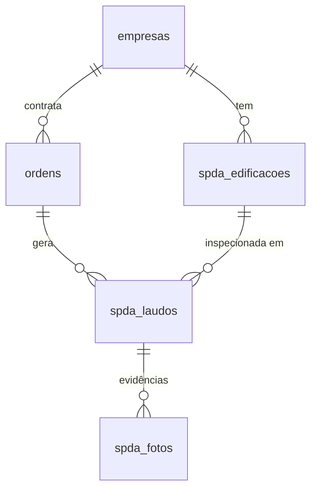

# SPDA (NBR 5419) — Etapa 1: arquitetura e modelo de dados

Módulo de laudos de SPDA **dentro do sistema da Termografia** (mesmo app, mesmo login CRONOS, mesmo
Firebase `idealle-termografia`). Clientes e OS vêm do **Finanças**; o laudo concluído vai para o
**Portal do Cliente**. Decisão do dono (13/11/2026): Firestore em vez de PostgreSQL, para não ter
segundo banco, servidor próprio nem cadastro de clientes duplicado.

## Equivalência com as tabelas do escopo

| Escopo (PostgreSQL)      | Aqui (Firestore)                                   | Observação |
|--------------------------|----------------------------------------------------|------------|
| Clientes                 | `empresas/{id}` (já existe)                        | Cadastro único no Finanças, chave = CNPJ. O SPDA só lê. |
| Edificações / Obras      | `spda_edificacoes/{id}`                            | Várias por cliente; guarda o nível de proteção (NP). |
| Laudos                   | `spda_laudos/{id}`                                 | Liga OS + edificação; status Rascunho / Em revisão / Concluído; ART. |
| Itens de checklist       | `spda_laudos/{id}.checklist[]`                     | Dentro do laudo (um documento só = funciona offline e salva de uma vez). |
| Medições                 | `spda_laudos/{id}.medicoes`                        | Aterramento (Ω), continuidade (Ω), equipamento e limites. |
| Evidências fotográficas  | `spda_fotos/{id}`                                  | Uma foto por documento (base64 reduzido, < 1 MB); o item guarda os ids. |
| (OS / contrato)          | `ordens/{id}` (já existe, serviço `spda`)           | O laudo nasce de uma OS do Finanças. |
| (Portal)                 | `portal_laudos/{empresaId}` (já existe)            | PDF publicado para o cliente, como nos outros laudos. |



## Documentos

### `spda_edificacoes/{id}`
| Campo | Tipo | Exemplo / regra |
|---|---|---|
| empresaId, empresaNome, cnpj | string | cnpj só dígitos |
| nome | string | "Galpão 2" |
| endereco | {logradouro, numero, bairro, cidade, uf, cep} | |
| atividade | string | uso / ocupação |
| dimensoes | {comprimentoM, larguraM, alturaM} | |
| tipoEstrutura, coberturaTipo | string | concreto armado, metálica… |
| nivelProtecao | {np: I–IV, origem: informado \| calculado, analiseRisco} | |
| metodoCaptacao | franklin \| malha \| esfera \| misto | |
| qtdDescidas | number | |
| ativo, criadoEm, atualizadoEm | | |

### `spda_laudos/{id}`
| Campo | Tipo | Regra |
|---|---|---|
| osId, osCodigo | string | OS do Finanças com o serviço SPDA |
| empresaId, empresaNome, cnpj, edificacaoId, edificacaoNome | string | cópia para listar sem consultar outras coleções |
| numero | string | `SPDA-0001/2026`, dado ao concluir |
| tipoInspecao | inicial \| periodica \| descarga \| modificacao | |
| dataInspecao | AAAA-MM-DD | |
| status | rascunho \| revisao \| concluido | ver fluxo abaixo |
| nivelProtecao, metodoCaptacao | string | copiados da edificação, editáveis |
| checklist[] | {codigo, bloco, texto, r: C\|NC\|NA, obs, fotos[]} | 32 itens em 6 blocos (`spda-dados.js`) |
| medicoes | {equipamento, metodo, aterramento[], continuidade[], limites, clima, soloUmido} | |
| conclusao | {parecer: conforme \| conforme_ressalvas \| nao_conforme, texto, recomendacoes} | |
| periodicidadeMeses, proximaInspecao | | padrão 12 meses, ajustável |
| inspetor, responsavel {nome, crea, art {numero, data}} | | ART obrigatória para concluir |
| historico[] | {quando, quem, o} | |

### `spda_fotos/{id}`
`{ laudoId, item (código do checklist ou ""), dataUrl, legenda, criadoEm }`

## Regras de negócio (em `spda/spda-dados.js`, com teste em `spda/teste-spda-dados.js`)
- **Níveis de proteção**: raio da esfera rolante, malha e distância entre descidas por NP (I a IV).
- **Medições**: continuidade acima de 0,2 Ω e aterramento acima da referência (10 Ω, ajustável) viram
  não conformidade automática.
- **Fluxo**: Rascunho → Em revisão (checklist completo, NC descritas, aterramento medido) →
  Concluído (parecer, responsável, CREA e ART). Concluído pode voltar para revisão.
- **Ao concluir**: número `SPDA-0000/AAAA` e próxima inspeção = data da inspeção + periodicidade.
- Conferir os valores de referência com a edição vigente da NBR 5419 antes de usar em laudo real.

## Estrutura de pastas (repositório idealle-termografia)
```
index.html                 app de campo (Termografia) — ganha o seletor Termografia | SPDA na etapa 2
spda/
  MODELO-DE-DADOS.md       este documento
  spda-dados.js            Etapa 1: coleções, NP, checklist NBR 5419, fluxo e validações (sem tela)
  teste-spda-dados.js      teste do modelo (node spda/teste-spda-dados.js)
  index.html               Etapas 2 a 5 (primeira versão): lista de laudos, edificações, checklist mobile com
                           câmera por item, medições, conclusão/ART, fluxo de status e PDF; offline pelo
                           cache do Firestore (enablePersistence). Modo de teste: /spda/?demo=1
portal/                    Portal do Cliente (recebe o PDF concluído)
cronos/                    Finanças (OS com serviço SPDA; pendência some quando o laudo é concluído)
```
Regras do banco: `firestore.rules` no repositório painel-central (coleções `spda_*` só para a equipe logada).

Acesso: menu da Termografia › SPDA (NBR 5419), ou /spda/. Usa a mesma liberação da Termografia no CRONOS.
Ao concluir, a OS recebe `resultados.SPDA.itens` (número, edificação, parecer, próxima inspeção).
